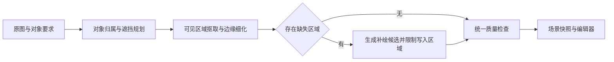

# 拆图内核重构调研与验收方案

日期：2026-11-03。代码基线：`5b04c5d`，最近一批真实生成后端为 `03ed3b4`。

状态：已完成源码审查、既有实验复核及论文/官方实现调研，并按用户要求自检修订（第8节）；本文是待实验验证的改造方案。本次没有安装新模型、执行新一轮推理或切换生产引擎。论文成绩、已有本机实测和设计目标分别记录，不能相互代替。

## 1. 判断与证据

建议先改造拆分内核的保真契约与入口一致性，保留已有可复用能力；是否扩大到重写，由同输入对照实验决定。代码与失败样本支持一个高优先级问题：整件生成之后再修复几何和颜色，没有为所有路径建立可见像素保护。不过这些观察尚不能证明整件生成是所有缺陷的唯一原因，也没有证明新组合更优。仅靠提示词、配准和重试不能提供原像素不变的硬性保证。

最近四张新复杂图共执行六个任务、输出26层，其中只有一次全自动整图，其余五次是指定清单及独立复拆。助手逐图目视复核记录为2层 `PASS_OBSERVED`、5层 `NEEDS_REVIEW`、19层 `FAIL`；这是独立于内置复核的记录，并非美术人员的独立盲评。四张整图均未全部通过。样本主动覆盖困难遮挡、透明材质、细字，不代表一般生产失败率。两次重复输出的相似程度也不代表它们都正确。[完整记录](upstream-20261102-comparison.md#四张全新复杂图与独立复拆2026-11-03)

后端155项、前端125项回归通过，说明这些工程行为有保护；它们不是生成质量的验收依据。27个既有工程哈希不变、PSD回读正常，也不能证明图层内容忠于原图。

| 已观察机制或风险（非完整因果证明） | 源码或实测证据 | 改造目标 |
|---|---|---|
| 整件重绘会改变已经可见的信息 | `expanded_assets.py:27` 起生成整件透明素材，58行调用通用生成；人物手势、钥匙齿、牌面、标题在复拆中改变 | 可见不透明核心保留原像素，生成只提供缺失区域候选 |
| 生成之后配准，不能修复局部重画 | `asset_geometry.py:6` 使用 SIFT/RANSAC 全局变换；身体与手部可能发生不同的变形 | 原图坐标和可信区域先固定，配准只作候选诊断或受限回退 |
| 有透明通道不等于正确分层 | `expanded_assets.py:6` 检查 RGBA、空图、尺寸和贴边，无法识别玻璃内部烘焙的旧背景 | 分开检查对象归属、边缘 alpha、前景颜色、材质和遮挡 |
| 不同入口质量契约不一致 | `incremental_assets.py:183` 有逐项复核和有限返修；扩展助手路径返回 `NOT_REVIEWED`，没有同等复核 | 全自动、指定对象、局部修复进入同一质量关卡 |
| 当前完成判定排斥非生成提取 | `assistant_split.py:88`、`incremental_assets.py:171` 要求真实生成记录 | 增加明确的原图抠取来源类型，不能伪造 `actualImageGeneration=true` |
| 补绘画布与原图坐标耦合 | 珠宝全自动素材越界，夜市画板膨胀；直接改原画布会影响续拆规划 | 原图坐标永久固定，展示/导出边界独立记录 |

以上路径均相对于 `legacy/拾界插件/开发源码/自动拆图/`。现有系统并非只有整件重绘：`workflow_assets.py:247` 调用 `asset_completion.calibrate`；`asset_completion.py:94` 恢复可见像素，173行起局部返修，201行检查范围外像素未变；`assistant_split.py:81` 的纯扩图分支也恢复原中心区域。已有能力应复用，缺口是前置对象归属、跨入口硬约束和真实图像质量。

本批珠宝9层中有3层登记为 `source-visible-with-inferred-completion`，其中蓝瓶与钥匙在助手目视检查中仍失败，丝绒袋为 `PASS_OBSERVED`。这说明混合处理已经存在，也不能单凭“用了混合方法”认定质量可靠。不同对象之间不能构成方法优劣的受控比较。

原像素恢复依赖轮廓、排除区和配准可信度，不能当成已解决对象归属。把原 RGB 直接贴回半透明边缘也会保留旧背景和产生接缝。

## 2. 论文与实现筛选

优先核对作者论文、官方仓库、权重及许可证。表内“候选”不表示已在本机跑通。仓库许可证不自动覆盖所有下载权重和上游依赖。

| 方案 | 适用问题及证据 | 限制与决定 |
|---|---|---|
| SAM 2 / SAM 3 | 实例归属和可纠正的对象掩码；SAM 3 支持文字和视觉提示。[官方实现](https://github.com/facebookresearch/sam3) | 已有 SAM 2.1 MPS 基线仍会切掉细件；SAM 3 官方环境面向 CUDA，权重需申请访问，不能预先承诺 M4 可用。先保留 SAM 2 基线，另测 SAM 3；它们不负责补绘或精细 alpha。3.1 的主要更新涉及视频，不据版本号推断静态抠图更好。 |
| ViTMatte | trimap 引导的精细 alpha，已接入 Transformers；代码 MIT。[官方实现](https://github.com/hustvl/ViTMatte)、[论文](https://arxiv.org/abs/2305.15272) | 优先作为边缘细化实验，复用现有依赖。需要正确的前景/背景/未知区，不能修复错误的对象选择；仍需估计边缘前景颜色。未测本项目 M4 性能。 |
| Matte Anything（补充直接组合依据） | 已有 SAM、透明性预测、伪 trimap 和 ViTMatte 组合的论文及实现。[论文](https://arxiv.org/abs/2306.04121)、[官方代码](https://github.com/hustvl/Matte-Anything) | 比各单模型分别有效更直接地支持组合路线的可研究性；原实现含 Detectron2/GroundingDINO，不能据此认定现有依赖足够、M4 可直接运行，也不能推导遮挡补绘或整图分层已解决。 |
| SDMatte / LiteSDMatte | ICCV 2025 交互式抠图，点、框、掩码提示，提供代码与权重。[官方实现](https://github.com/vivoCameraResearch/SDMatte)、[论文](https://arxiv.org/abs/2508.00443) | 与 ViTMatte 对照测试发丝、流苏、半透明边缘。实现有 CUDA/Detectron2 依赖，MPS 适配需验证；代码 MIT 不替代基础模型许可。alpha 模型不等于完整的玻璃重合成模型。 |
| LayerD | ICCV 2025，面向平面设计图的逐层分解，使用专门训练的 BiRefNet，含前/背景颜色分离及 SVG/PSD 流程。[官方实现](https://github.com/CyberAgentAILab/LayerD)、[流程说明](https://github.com/CyberAgentAILab/LayerD/blob/main/docs/pipeline.md) | 很适合比较标题、UI、图形素材，不能假设能补全复杂人物。代码 Apache-2.0；仓库已于2026-10-30归档。作为专项基线和算法参考，不整包替换服务。 |
| Qwen-Image-Layered | 原生多层 RGBA，层数可变；官方示例采用50步，明确推荐640分辨率档，提示词描述整体场景。[官方实现](https://github.com/QwenLM/Qwen-Image-Layered) | 本机30步测试未通过，尚未覆盖官方示例设置。保留完整分层对照组，不直接成为默认方案。层名与提示词不能视为每个指定对象必定独占一层的保证。 |
| Qwen-Image-2.1 | 官方说明支持原生 RGBA 生成、编辑及主体提取。[模型卡](https://huggingface.co/Qwen/Qwen-Image-2.1) | 值得研究评估，但当前权重是 Qwen Research License，限定非商业研究/评估，商业使用需另行授权；不能默认用于公司生产。[实际许可证](https://huggingface.co/Qwen/Qwen-Image-2.1/blob/main/LICENSE) 本项目未做 M4 测试。 |
| PixelART | 2026年9月论文，直接在像素空间预测区域 RGBA，避免重型文生图基础模型和 RGBA VAE，方向符合素材保真需求。[论文及附录](https://arxiv.org/html/2609.22789v1) | 论文也报告复杂遮挡和自然图像局限；依赖外部布局，训练数据和内部检测器未公开。本次未核实可直接接入的完整公开权重/流程。跟踪复现，不把论文速度当成本机成绩。 |

其他已查方案：

- [Stable Layers](https://github.com/Stability-AI/Stable-Layers) 是 Qwen-Image-Layered 上的 LoRA，并非独立轻量模型；官方推荐640、4层、50步 Heun，偏离设置可能降低质量。它可做后续对照，不优先解决本机时延与原尺寸细字问题。
- [ZIM](https://github.com/naver-ai/ZIM) 的精细掩码有参考价值，但代码及模型标注 CC BY-NC 4.0，不选作公司的默认生产组件。
- [OmniPSD](https://github.com/showlab/OmniPSD) 提供生成式 PSD 方向的实现，但依赖 FLUX 系列及配套组件；尚无本项目端到端和 M4 证据，不因为输出 PSD 就等同于保真拆图。

玻璃必须单独验收。单张图中的玻璃像素混合了前景、旧背景、反射和折射；只预测 alpha 通常不足以移除旧背景。普通 RGBA 合成也不能表达对任意新背景的真实折射。[透明与折射物体合成研究](https://www.microsoft.com/en-us/research/publication/matting-and-compositing-of-transparent-and-refractive-objects/) 支持将衰减、折射等独立建模。因此近期目标应是可用的 RGBA 近似及明确限制，不能宣称换一个抠图模型便能完全解决玻璃。

## 3. 三条路线的取舍

| 路线 | 收益 | 代价/风险 | 决定 |
|---|---|---|---|
| 继续通用生成，再增加提示词与重试 | 修改少、遮挡补绘能力现成 | 不锁定可见像素；费用和时延增加，重复输出仍改变细节 | 仅保留已有引擎作对照及回滚 |
| 整体换成单一专用分层模型 | 流程短，有联合分层训练 | 层归属、原分辨率、精细字形、硬件和许可证均有未解决风险 | 并行基线，实验通过后可承担合适场景 |
| 原图提取 + 精细抠图 + 受限补绘 | 已正确识别的不透明核心可由程序保证不被改写；失败能定位到具体阶段 | 掩码与遮挡归属必须正确，半透明边缘及隐藏区域仍难 | 优先验证假设，先证明最小路径；不是已证明更优的方案 |

## 4. 最小目标结构

保留 Django/Postgres 任务与用户隔离、既有本机 Worker 桥接、公司 Agent/Codex 连接、项目保存、编辑器及 PSD 导出。只在现有任务执行边界增加新拆分实现；不增加新的数据库、消息队列或微服务。

四个职责足够；先可在少量普通 Python 模块内完成，无需插件注册系统。

1. **对象归属。** 接收对象名称、框、可选正负点，输出可见掩码、遮挡关系和材料类别。框只是搜索范围。对邻物、孔洞、重复实例和细件做检查；不再直接把两个模型掩码硬相交后认定正确。人工修正与全自动结果分别记账。
2. **保真提取。** 在可信的不透明核心复制原像素；未知边缘用 matting，并估计前景色，防止带入旧背景。牌面、文字、图标保持原栅格；OCR 用于定位和检查，不能默认换字体重排。完整可见对象无需调用生图。
3. **缺失补绘。** 仅为被遮挡或出界部分生成候选。即使提供商无法保证遵守 mask，也由本地合成限制能写入的区域；过渡带明确属于待估计区，不允许改动可信核心。补全仍属推断，需检查接缝、肢体、材质和视角。
4. **质量与输出。** 所有入口共用同一规则，给出图层及场景结论；任务执行成功与视觉通过保持独立。单项失败保留已有最佳候选和原因，不盲目重新生成整张图。

### 数据与接口契约

- **原图事实源不变。** 保存原文件哈希，以及经过明确 EXIF/色彩规范化的解码像素哈希。既有任务的旧哈希语义不改写。锁定像素断言使用同一规范化像素域，避免把 PNG 编码差异当内容改变。
- **坐标永久以原图为准。** 每个素材记录整数像素原点，可为负；补绘边界与预览/导出画板边界独立。编辑器用户变换单独记录，不反向改写原图、掩码或生成参考坐标。
- **最小产物。** 原图身份、对象 ID、RGBA 文件与哈希、原点、可见/推断/不确定区域的掩码引用、处理方式、质量证据。处理方式明确区分 `source-matted`、`masked-completion` 和旧生成结果；实际生成调用才携带真实生成凭据。
- **版本化执行。** 新任务记录引擎版本、模型版本、参数、种子（若有）和已完成阶段。续跑复用核验过的产物；用户编辑不得被恢复任务覆盖。调用结果不确定时先查询已有记录，不自动重放付费请求。
- **单一写入者。** Worker 生成新结果快照，项目保存仍由现有保存流程管理。模型进程只接收受限任务目录中的图像/掩码及参数，不接收公司或 Codex 凭据，不直接写用户项目。
- **失败分类。** 执行失败、中断、质量不通过、未复核分别保留。尺寸超限、无效掩码、源哈希不一致、坐标非有限值在入口拒绝；模型失败不得被当成空透明层成功保存。
- **兼容导出。** 最初经适配器输出现有 scene v2，内部新元数据带版本。补绘边界不能裁丢有效像素；异常膨胀需要显示原因，不能静默缩小图层。PSD 回读需复核像素、图层顺序、坐标和画板。

## 5. M4 Max 与部署边界

现有 Qwen-Image-Layered 隔离实测：4层、30步、640分辨率参数、seed 42，用时2162.3秒（约36分钟，包含约100.1秒模型加载），输出4张768×512 RGBA。`tools/local_model.py:88` 只在采样步回调中读取 `driver_allocated_memory()`，记录的最大观测值约81.4 GiB，不是全生命周期精确峰值，也不是系统总内存或纯模型张量占用。存在猫尾归属、玻璃背景残留和背景糊化。它证明该配置能运行，未证明质量达标，也不是所有配置的结论。[本机记录](verification.md#2026-11-03-多图压力测试本批结束未通过稳定性验收)

当前 Web 本机路径还固定为3层、20步、640（`shijie/pipeline/local_model.py:83`），与上述实验及官方示例的50步设置都不同。下一次比较必须记录并区分配置，不能混称“Qwen 效果”。

优先在已有原生 macOS/MPS Worker 中评估分割和 matting，Web/数据库继续使用 Ubuntu Docker。保持推理进程可释放内存，记录冷启动、热运行、峰值占用和失败恢复。新候选未做 M4 实测，不能以128 GB容量直接推导速度或算子兼容性。远程 Ubuntu 只有在确认实际 GPU 和驱动后才能制定性能承诺；现阶段不以采购新卡代替质量验证。

## 6. 验收必须先于切换

先冻结本轮四张图与26层结果作基线，再补充有真实图层的样本。AI 新生成的扁平原图没有隐藏部分的真值；无限生成更多这种图，不能验证补绘恢复了原本不可见的内容。

最小实验包含：红中牌面、武侠金色标题（原像素和字形）；人物手与牌桌（遮挡和接触位置）；钥匙/流苏（孔洞和细件）；玻璃壶（透明材质挑战，单独报告）。先验证单个对象，再由同一实现串入自动整图，不接受只修当前实例。

| 检查 | 可执行证据与通过条件 |
|---|---|
| 可见核心不变 | 对确定属于目标的不透明核心，检查原坐标 RGB 字节完全一致。核心是否选对另用真值检查，不能靠“复制了背景也一致”通过。 |
| 邻物和细部归属 | 在已知分层的合成图及美术原 PSD 上，检查错层泄漏、遗漏、孔洞、文字笔画和肢体接触点；分开报告每个对象。 |
| 边缘质量 | 对有 alpha 真值样本比较 SAD、梯度/连通误差等，并实看黑、白、棋盘底；同时看前景颜色污染。阈值由固定真值样本校准后冻结，不能看结果后放宽。 |
| 补绘限制 | 检查允许区域外像素不变；隐藏区域有真值时单独比较，无真值时只判连贯性和合理性，不能称精确还原。 |
| 整图复合 | 比较合成重建误差，同时检查逐层归属。防止“整张原图放背景、其他层为空”投机通过。 |
| 重复稳定性 | 同输入至少3次独立运行仅作为发现波动的最低调试检查，不能证明高成功率；支持种子时固定种子与变种子分组。报告所有结果、失败项、人工修正次数、耗时及费用，不挑最好一遍。稳定性结论还需独立留出图片、按材质/遮挡分组和足够样本量。 |
| 自动路径真实性 | 全自动、人工点选、真值掩码三组分开。真值掩码用于定位抠图/补绘瓶颈，不能记为自动识别成功。 |
| 保存与导出 | 真正打开、保存、恢复、续跑和导出，再独立回读 PSD；源图、旧项目不变，负坐标和补绘边界完整，没有重复生成。 |

现有自动视觉复核可以提示问题，但不能单独判定新引擎达标。初始发布关卡为上述固定关键案例没有已知严重缺陷、硬性不变量全部通过，且完整多图结果优于旧基线；这不等同于对所有图片的质量保证。当前尚未冻结质量阈值和独立留出集，因此该关卡仍不具备正式发布判定条件。若玻璃未通过，应明确保留待修标识，不能用其他样本平均分掩盖。

具体对照必须包含三组：A为当前路径，B为复用现有模块、只统一可见区保护和复核的最小修改，C为新增分割/matting组件。输入、对象要求、生成提供商及参数一致，记录全部尝试和人工干预。先用真值掩码定位限制，再测自动掩码；在看留出结果之前冻结各类判定标准。若B已解决目标问题，应停止扩大重写。

## 7. 迁移、回滚和删除

1. **基线实验。** 用现有失败样本和已知图层合成样本，先比较现有 SAM 2 路线、ViTMatte、适用时的 LayerD/SDMatte。模型下载和适配只在需要验证该候选时进行，不同时堆装全部依赖。先验证对象归属与边缘，再接补绘。
2. **最小纵向路径。** 一个指定对象完成提取、硬约束检查、scene v2 输出、浏览器恢复和 PSD 回读。代码检查先证明坏掩码/核心像素变化会失败，再用真实模型结果确认改善。
3. **受限补绘。** 复用现有公司 Agent/Codex 提供商选择规则，加入可见核心保护和推断区域标记；比较人物/桌面失败样本，验证中断后不重复生成。
4. **完整自动场景。** 同一实现扩展到多个对象，统一遮挡顺序、质量复核和画板处理。再用未参与调参的新复杂图验证，并独立重复运行。
5. **切换新任务。** 只有验收通过后新任务默认使用新引擎；旧项目保持可读，既有运行任务固定原引擎。历史结果不重算、不改写成通过，不因打开项目产生费用。
6. **回滚。** 后续新任务可切回旧引擎，新结果保留独立快照；不得把一个执行到一半的付费任务静默切引擎重跑。旧场景读取兼容与引擎执行回滚分开处理。
7. **删除旧实现。** 自动、指定对象、局部修复、续跑和导出均通过同一验收后，才删除重复的整件生成/校准修补路径。仅被旧格式读取需要的逻辑保留在兼容入口，不能双写同一项目。

当前决策不要求全面重写前端或增加基础设施。先证明新内核确实保住字形、牌面、手势、细边和坐标，再扩大重构范围。

## 8. 自检结论与证据边界

本次自检重新读取原始任务和图片，复算26层 PNG 的哈希及登记值、输入哈希、六个任务的层数与完成状态、27个旧项目哈希；重新统计复核标签，读取 Qwen 原始请求、结果及 PNG 头尺寸。结果见本机 `output/stability-new-20261103/research-self-audit.json`。哈希一致证明记录与素材一致，不能证明画面正确，也不是第三方对生成服务的认证。

在现有 Ubuntu Docker 中复跑 `tests.test_source_fidelity` 与 `tests.test_asset_completion`，40项全部通过（测试运行器耗时0.712秒）。它们使用合成图像/模拟模型边界，验证现有原像素恢复、遮挡排除、局部返修范围限制等行为；不涉及真实模型调用，不能作为新模型或完整拆分质量通过的证据。命令、退出状态和测试文件哈希已记入同一自检结果。

重新目视抽查了麻将人物、武侠标题、蓝玻璃瓶三件已有对比图，确认手部重影、标题材质改变和深浅底下瓶塞几乎不变的现象。本轮没有重新目视评定全部26层，不把标签复算称为重新完成全部质量验收。对玻璃来说，固定反射也会在换底后保持不变；缺少材质真值，不能只凭这一项现象证明每处都是旧背景污染，因此保留风险判定而不宣称物理级准确诊断。

| 上轮结论 | 自检判定 | 修订依据 |
|---|---|---|
| 6任务、26层、2/5/19标签 | 原始记录复算一致 | `receipts.json`、`verdicts.json`、真实 `input.json`/`result.json`；1次全自动加5次指定清单，不能扩称6次全自动 |
| 所有路径都靠整件重绘，没有保真能力 | 这种概括不成立 | 已有可见像素恢复、纯扩图原区恢复、局部返修范围外不变断言；本批3层实际使用混合来源 |
| 已证明应重写，且组合路线更稳 | 证据不足 | 缺少同输入A/B、固定真值和盲评。改为先验证保真契约的最小修改，再决定重写范围 |
| 81.4 GiB是MPS峰值 | 数值正确，口径需要纠正 | 是推理步回调采样最大值，未连续监测模型加载和解码阶段 |
| 至少3次重复即可保证稳定 | 不成立 | 3次只能发现部分波动；同一图、同一种子存在相关性，不能外推到图片总体 |
| 候选具备所述研究能力 | 所列主要能力有官方来源，产品适用性未证实 | 重查原始README、论文及许可；新增 Matte Anything 的直接组合依据 |

数理边界也必须明确：普通合成满足 `C = alpha * F + (1-alpha) * B`。只有确定对象归属且 `alpha=1` 的核心能直接使用 `F=C`；在未知前景色、背景色及 alpha 的半透明区域，单张 RGB 观察不能唯一确定三者。对完全被遮挡部分更没有直接原像素证据。故“锁原像素”是有限区域内的程序保证，不是完整素材正确的证明。

外部资料复查保留了 Qwen-Image-2.1 研究许可、LayerD 归档、SAM 3 CUDA 环境和 PixelART 公开复现限制等结论；没有把模型版本、演示图或作者报告当成本机实测。新增候选仍未运行，本项目尚未获得稳定性通过结论。
